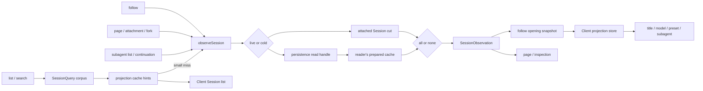

# Agent Note: Session observation 與 projection 所有的用戶端狀態

Status: implemented

[English](2026-08-25-session-observations-and-projection-owned-client-state.md) | 中文

## 問題

面向 Session 的多個消費方需要相同的邏輯資料，卻各自完成解析。list、follow、page、附件／fork 讀取和 subagent 檢查分別在已掛載 Session、持久化中繼資料、prepared Session 與 projection cache 之間作選擇。因此一次頁面存取可能多次物化同一份冷日誌，各自拼裝的 header、事件、cursor 和 projection 值也可能來自不同的讀取切面。

用戶端功能還以多種形式儲存 Session 派生事實。title 有專門的 list 和更新邏輯；模型選擇把 Session 專用 catalog 請求與本地狀態混在一起；agent preset 展示可能在目前 Session 到達前猜測全域預設值；subagent list 則單獨掃描或重建 identity。這些映像產生了中間狀態：即使持久化 Session 已經決定答案，UI 仍會短暫顯示猜測出的預設值、原始 id 或不可用狀態。

僅統一持久化讀取，Client 映像仍會成為互相競爭的真源。僅統一 Client 欄位，各 Host 入口仍可能獲得不同的資料切面。因此讀取單元與派生狀態單元需要一條配套的 ownership 規則。

## 決策

Session 精確讀取使用可保留的 `SessionObservation`，向 Client 暴露的可回放 Session 派生值使用已註冊 projection。Observation 負責選擇資料來源和提供一份不可變讀取切面；projection 負責從該切面派生狀態。API 層只選擇要釋出的內容，Client 只消費成品值，不從事件重建 Session 事實，也不在各領域映像中重複儲存這些事實。

### 資料動線

兩條 ownership 規則在 observation 的 projection snapshot 處匯合。輕量 list 可以止於 cache hints；每次精確 opening 都進入同一 observation 路徑，並向 Client 提供完整 replacement baseline。

### Observation 是 point read 單元

`SessionQueryEngine.observeSession(sessionId, options)` 返回可 dispose（資源釋放）的 `SessionObservation`，其中包含同一份 source kind、header、連續事件字首、cursor、可選 projection snapshot，以及 prepared source 的持久化 revision。已掛載 Session 優先；否則由讀取方自己的 prepared cache——以 `stat().revision` 為鍵、由 observation lease 固定——提供冷 Session，讓並行 observation 共享同一次持久化讀取（`open(id, 'read')` + `read`），包括尚未完成的冷載入。

每個 owner 都會 dispose 自己的 observation。`retain()` 為同一切面建立另一份 lease，使 `session.follow` 能夠先發布 snapshot，再把完全相同的 prepared source 轉交給後臺 Agent promotion，而無需重讀日誌。冷解析期間出現的 live Session 會在釋出前勝出；已經消失的 live source 會按 cold source 重試。

### 資料來源解析與生命週期

一份 observation 把所有返回欄位繫結到同一 lifecycle witness。呼叫方不會把 corpus list 的 header、persistence 的 events 和稍後 live Session 的 projections 拼在一起。選中的 header 與事件字首共同產生 cursor 和 projection snapshot。live observation 在讀取時以日誌長度固定 cut，並在首次存取時才物化 `events`；日誌只會追加，所以無論消費者多晚讀取，該字首都完全相同，而只需要 header、cursor 或 projections 的消費者永遠不會複製日誌。

系統在 cold borrow 前後都檢查 live 優先順序。第二次檢查封住 persistence 載入期間 Agent 完成 attach 的競態。如果 persistence 報告由 live source 勝出，但 SessionQuery 檢查時該 source 已經 detach，解析會重新開始，而不是釋出一份無人持有的引用。

只有在不存在已掛載 Session 後，persistence absence 才對映為 Session-not-found。持久資料損壞、source identity 衝突、取消和 persistence 操作失敗分別保留不同的 `SessionQueryError`，API owner 因而可以維持自身公開錯誤詞彙，而不用重複資料來源判定。

Observation 不擁有任何 mutation 權限。其事件陣列是不可變字首，prepared Session 保持未釋出。Promotion 是 Session Controller 在 opening snapshot 發出後執行的顯式 ownership transfer；其他讀方不能把 observation 變成 live Agent。

Projection 工作明確只有 `all | none` 兩種模式。`all` 在 observation 的事件 cursor 上計算所有已註冊 projection；`none` 完全不觸碰 projection 狀態。系統不存在按 key preparation 的狀態、`projectionKeys` 模式或額外的 `viewedState`／`viewedValue` cache。釋出方可以按 audience 篩選已完成的值，但底層 observation 不會處於只算完部分 projection 的狀態。

### Projection 執行邊界

對於 live source，`all` 讀取一份同步 registry snapshot。對於 prepared source，projection cache 可以播種有效 state row，隨後每個已註冊 unit 在精確的剩餘事件字首上推進。得到的 Client value 共用一個 `asOfSeq`。

篩選發生在計算完成之後，因為它改變的是披露內容，而不是狀態。Page 授權驗證可以只消費 `subagent`，list row 可以只發布 list 相關值；只要它們請求 projection 工作，仍然依賴一份完整 projected cut。

Registry 擁有 fold state；各領域擁有自己的 `init`、`apply`、`view`、schema 和 `stateVersion`。SessionQuery 只知道是否需要 projection 工作，不理解 title、model、preset、subagent、token、image、plan、todo 或 goal 的語義。

`view` 保持為 folded state 上無 cache 的同步轉換。其成本由已註冊 projection unit 數量界定，並在 snapshot 釋出時支付；引入第二層 cache 只會增加 invalidation 狀態，無法減少 event replay。

語料庫 list 仍是獨立的輕量操作。`listSessions()` 返回 live-preferred header，而不物化每份日誌。Session list 先讀取 live projection 狀態或持久 projection-cache row。Subagent 發現透過精確 observation 讀取父目錄 projection。當 cache 無法判斷 Session 是否為空，且該 Session 擁有的獨立產物未超過設定的小日誌限制時，Session list 可以執行一次完整 observation；大型或不可讀的 cache miss 仍以 hints 未知但 row 可見的方式返回。

`session.follow` 釋出必需的 opening snapshot，其中包含 header、cursor、首個事件視窗和完整 projection baseline。重連使用另一份完整 snapshot 替換上一 generation。`session.page` 僅用於舊歷史讀取與 gap repair。只讀 observation 不啟用 Agent；只有普通 follow 可以保留 prepared observation，並在 opening snapshot 已交付後請求 promotion。

### 讀取 audience

每個公開操作選擇一組查詢與 projection 策略。該選擇屬於操作本身的行為，而不是 persistence 或 transport 內部的啟發式判斷。

| 操作 | 讀取路徑 | Projection 策略 | Agent 啟用 |
|---|---|---|---|
| `session.list` | Corpus header、live state 和 cached row；有界小日誌 fallback | 部分 hints，或一次完整小日誌 observation | 從不 |
| `session.search` | Corpus 授權驗證加已設定 search provider | 結果列表不計算 | 從不 |
| `session.follow` | 一份精確 observation | 全算，並由 opening snapshot 攜帶 | 僅普通 cold Session，且在 snapshot 交付後 |
| `session.page` | 一份精確 observation | 不計算，但 projection-backed subagent 授權驗證除外 | 從不 |
| Attachment 與 fork source | 一份精確 observation | 授權驗證不要求時不計算 | source 從不啟用 |
| Subagent list 與 continuation | Listing 觀察父目錄；continuation 觀察目標 | 全算；listing 消費目錄值，continuation 消費身份與繼承值 | Listing 從不；continuation 遵循顯式命令語義 |

### 可回放的 Client 事實歸 projection 所有

當一個 Client 可見值由 Session header 或事件日誌決定，並且必須在重新整理、冷存取或重連後恢復時，它屬於 `SessionProjectionMap`。這條規則覆蓋 title、list metadata、model selection、agent preset selection、subagent identity 和 subagent timing。各領域包擁有純 projection definition；Session transport 與 Client value store 不理解具體領域。

Projection 的三種交付狀態含義不同：

- Session-list hint 是可選、部分且可能陳舊的資料。key 缺失表示未知，因此 list 消費方不得自行補成空值或部署預設值。
- Follow opening baseline 是其 cursor 上所有已註冊 Client 可見 projection capability 的完整集合。此處缺少 key 表示目前 Host composition 不具備該 capability。
- 顯式 `null` 是領域計算出的無值結果。它不同於 list hint 缺失，並且能夠完整透過 JSON transport。

這些區別避免由一個過載的 `undefined` 同時表示 cache miss、plugin 未載入和真實領域答案。API 型別把 list 資料命名為 hints，把 opening 資料命名為 baseline，因此消費方不能只因兩者都攜帶 projection value 就假定其完整性相同。

### Client 合併規則

| 輸入 | 完整性 | 新鮮度 | key 缺失的含義 |
|---|---|---|---|
| Session list hints | 部分 | 上次持久 checkpoint 或有界 fallback cut | 未知 |
| Follow opening baseline | 對目前 Host composition 完整 | 精確 opening cursor | Capability 不存在 |
| Projection frame | 單個完整 key | Frame 攜帶的 event sequence | 不適用 |

Client 為每個 key 儲存一行。由建連 Host 算出的行帶 sequence number：更新的 baseline 或 frame 會替換它，相同或更舊的輸入被忽略，因此 reconnect 可以替換 event window，而不會退回已經在更晚 sequence 接受的 projection frame。從持久化快取看出來的 list hint 不帶可比的 sequence number，讓位於所有 Host 排序過的寫入（[Projection cache 只讀面按 lifecycle 身份匹配，用戶端 store 區分 cached 與 sequenced 行](2026-09-19-projection-cache-listing-identity-and-cached-rows.zh.md)）。

List view 與已開啟 Session 讀取同一個 per-Session store。Hints 可以在 follow 完成前填充 title、preset 和其他 list presentation；opening baseline 隨後收斂這份狀態，而不會建立第二套 summary-only authority。

每個 Session 的 Client projection store 接收 list hints、follow baseline 和後續 whole-value frame。higher-sequence-wins 只在 Host 排序過的值之間生效；cached list hint 排在它們全部之下。它從不折疊 Session event。Baseline 或 frame 可以推進 hinted value，較舊切面不能覆蓋較新的 sequenced row。

不由單個 Session 派生的資料不進入 projection。`session/modelCatalog` 持有目前 Host generation 的 model catalog，`agentPresets/list` 持有可設定 preset roster。Selector 只在相應 catalog 與 Session 的 `modelSelection` 或 `agentPreset` projection 均就緒後組合兩者。重新整理時可以保留上一份完整 catalog；第一次獲得完整輸入前顯示 loading，而不是展示猜測的名稱或可用性結論。

Client 本地互動狀態也繼續留在本地：loading 和 error 狀態、開啟的選單、進行中的選擇，以及為尚未建立 Session 暫存的選擇都不是可回放 Session 事實。選擇一旦應用到 Session，其持久事件與 projection 就成為權威。

### 領域應用

- **Title 與 list metadata。** Cached projection hints 可以渲染已有 title，並判斷 blankness 或 recency。Hints 缺失時這些事實保持未知；listing 期間只有有界小日誌策略可以解析它們。Client 使用目前 metadata projection 對帳列表行：非空白事實會將 Session 排除在空白複用之外，較晚的 prompt 時間用於最近活動排序。Projection store 的生命週期長於惰性建立的 Client Session 實例，因此實例化時即使尚無列表行，也會讀取已保留的中繼資料。過期列表回應不能覆蓋較新的 history 或 control projection。
- **Model selection。** `model/selection` 記錄完整 provider、model 和可選 reasoning effort。`modelSelection` 區分上一請求使用的 route，以及等待 request header 消費的較晚 selection。
- **Agent preset。** Projection 從不可變 Session metadata 初始化，並隨 preset-selection event 推進。對於現有 Session，缺失或 `null` 值不會替換成部署預設值。
- **Subagent identity。** `subagent` unit 仍是繼續執行與歷史授權的唯一 descriptor interpreter。Listing 透過父級 observation 從 `subagentCatalog` projection 派生成員關係、模式與標籤；後代發現遞迴讀取可達目錄（[父目錄決策](2026-09-01-parent-owned-subagent-catalog.zh.md)）。
- **Subagent presentation。** Opening projection value 在 Client 宣佈 child 可互動或離線前建立 timing 與 identity，因此 transport loading 不會偽裝成 durable state。

這些遷移刪除特殊 Client state，但不會讓 projection 接管 provider catalog 或互動機制。領域仍擁有 mutation 和 command；projection 只擁有其可回放 Session 結果。

### 失敗與 readiness 邊界

- List cache miss 不是錯誤，也不會隱藏 row。未知 hints 保持缺失，直到有界 fallback 或精確 opening 提供值。
- 精確 cold observation 中的 projection failure 使整份 observation 按損壞的 Session data 失敗；呼叫方不會發布成功 key 與失敗 key 的混合結果。
- 一個 subagent candidate 的 cold observation 失敗隻影響該 candidate 的 diagnostic row；sibling candidate 繼續可用。
- Catalog load failure 是 Client 可見的 catalog state。它不會在 refresh 期間清除上一份完整 catalog，也不會合成 Session selection。
- Follow carrier generation 只有在 opening snapshot 完成驗證與應用後才被接受。Reconnect 期間繼續顯示上一 generation。

取消會在文件規定的檢查點終止排隊中或進行中的 cold resolution，並釋放每一份已獲得 lease。取消不會變成 not-found，也不能讓 prepared entry 保持 pinned。

### Ownership 矩陣

| 事項 | Owner | 非 owner |
|---|---|---|
| Cold materialization 與 revision 檢查 | Session persistence | API Controller 與 Client |
| 精確 live-preferred read cut | SessionQuery observation | 各 endpoint helper |
| Fold state 與 Client-value 計算 | Projection registry 與 domain unit | SessionQuery 與 Client |
| 部分 list acceleration | Projection cache 與 list policy | Follow protocol |
| Opening 與 reconnect replacement | Session follow 與 journal stream | Session page |
| Per-key value ordering | Client projection store | Domain UI component |
| Provider 或 preset catalog lifecycle | 對應 catalog directory | Session projection |
| Rendering 與瞬時 interaction state | Domain UI package | Host projection unit |

### 擴充功能規則

1. 判斷新值是否屬於單個 Session 的可回放事實；如果屬於，先定義或複用其持久 header/event 輸入，再新增 Client 欄位。
2. 在 owning domain 註冊一個 pure projection unit。Fold state 與 Client view 表示不同時，分別定義其型別。
3. 讓精確讀方請求 `projectionMode: 'all'`；僅在建構 audience-specific response 時篩選。
4. 讓 list 消費方接受 optional hint。不能只為消除顯式 unknown state 而強制 hydrate 整個 corpus。
5. 把值送入通用 Client projection store。不能為同一事實再增加 dedicated reconnect fetch、event reducer 或 Session summary mirror。
6. 非 Session catalog 與 ephemeral UI state 保留各自 owner，並在和 projection value 組合前定義 readiness。

這些規則適用於新的 Session-derived Client state，即使在第一個呼叫點直接掃描 event 看似廉價。複雜度需要覆蓋 cold read、reconnect、多 tab、plugin lifetime 和未來消費方，而不是隻看首次實作。

### 與既有決策的關係

- [可複用 Session preparation](../../archived/architecture/2026-08-05-session-preparation.md)擁有冷物化、修復、reservation 和釋出。Observation 在該 prepared object 之上增加共享讀取 lease，並未把 preparation 移入 SessionQuery。
- [Session 歷史與 Remote event transport](2026-08-18-session-history-and-event-transport.zh.md)擁有 stream generation 與 replacement 語義。本決策提供每個日誌 generation 的精確 opening snapshot。
- [Projection state 與 Client view](../../archived/architecture/2026-08-19-session-projection-state-and-client-views.md)擁有 Host fold state 和 Client value 的區分。本決策規定這些值在哪裡消費，以及部分 list hints 與完整 baseline 的差別。
- [父目錄決策](2026-09-01-parent-owned-subagent-catalog.zh.md)擁有 subagent 發現機制。Descriptor folding、可序列化 `null` sentinel 和 own-suffix sequence 檢查仍用於繼續執行與歷史授權，不用於目錄身份。
- 更廣泛的 [session projection 與 command-log 提案](../../proposed/architecture/2026-07-27-session-projection-and-command-log.zh.md)仍為 proposed，其中尚未由已交付程式碼體現的部分不受影響。本決策記錄已經交付的 observation 與 Client ownership 子集。

## 驗證

Persistence 與 SessionQuery 測試固定共享冷載入、取消、live-source race、retained observation、dispose 和 all-or-none projection 計算。Session Controller 與 Gateway 測試固定 snapshot-first opening、replacement reconnect、舊分頁讀取、gap repair、list-cache hints、小日誌有界 fallback，以及 snapshot 交付後的 promotion。

Client 測試固定 higher-sequence-wins projection store、title 更新、model catalog 與 selection readiness、preset roster refresh 與 Session 專屬選擇，以及不會短暫展示離線狀態的 subagent loading。Subagent 測試固定父目錄順序、遞迴遍歷、分支診斷、取消、fork 隔離，以及 listing 期間不啟用 Agent。

## 考慮過的替代方案

**由各消費方繼續解析資料來源。** 否決，因為每個呼叫方都需要重複實作 live race、persistence error mapping、preparation lifetime、cancellation 和 projection cut，既會重複工作，也會產生不一致結果。

**每次精確讀取都啟用 Agent。** 否決，因為 list、history、attachment、search 與 subagent inspection 都是讀取操作。Activation 會載入外掛並改變程序狀態，也沒有適合分頁或 catalog 讀取的自然退出點。

**只 prepare 被請求的 projection key。** 否決，因為只完成部分 projection 的 Session 會增加一種生命週期狀態，所有 cache、restore、plugin registration 和呼叫路徑都必須追蹤它。Projection unit 數量少且為純函式；精確 observation 計算全部已註冊 unit，比為了 `O(E*k)` 而維護部分狀態、取代 `O(E*P)` 完整狀態更簡單。

**單獨快取每個 projection 的 viewed value。** 否決，因為 `view` 只是已摺疊 state 上的純同步轉換。第二層 `viewReady`／`viewedState`／`viewedValue` cache 會增加 invalidation 和 plugin lifetime 狀態，卻不能減少 event folding。

**保留專用 summary 欄位、RPC 或 Client reducer。** 否決，因為每一項都會在 event log 與 projection registry 之外建立第二個真源，還要求每個領域分別實作 baseline、reconnect 和 race handling。

**要求每個 list row 都攜帶完整 projection。** 否決，因為列出大型 cold corpus 時必須先讀取完整日誌，navigation 才能渲染。部分 cache hints 保留了輕量 list 路徑；在 opening 給出精確 baseline 前，消費方已經擁有明確的 unknown 狀態。

**在 catalog 或 projection 輸入缺失時渲染猜測預設值。** 否決，因為猜測可能明顯違背 Session，並在載入後發生跳變。初次不確定時顯示 loading；重新整理時保留上一份完整值，直到替代值就緒。

## 後果

Session 消費方共享一份 live-preferred read model 和一個 prepared cold object。Header、events、cursor 與 projections 屬於同一 observation，普通頁面開啟還可以為後續 promotion 複用該物件。新的 point-read 消費方使用 SessionQuery，而不再自行拼接 persistence 與 registry 呼叫。

Session 派生 Client 狀態只有一條擴充功能路徑：記錄或識別持久輸入、註冊純 projection unit，再透過通用 store 消費其成品值。不由 Session 派生的領域 catalog 可以獨立存在，但不能用預設值替代未知的 Session projection。

更簡單的狀態模型接受有界的額外計算。精確的 projected cold observation 會計算所有已註冊 unit，小型且 cache miss 的 list artifact 可能完整讀取。大型 list row 在開啟前可以保持部分描述，因此每個 list 消費方必須保留 unknown、capability absent 和 explicit no value 的區別。Observation lease 還使 dispose 成為呼叫方約定的一部分；保留 prepared source 而不釋放會阻止正常 cache retirement。
