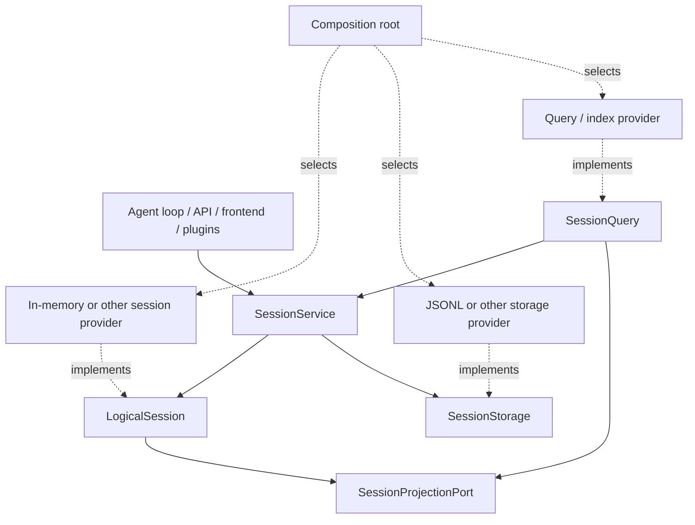

# Agent Note: Session 能力協定

Status: proposed

[English](2026-09-10-session-capability-protocols.md) | 中文

## Problem

保留舊 `Session` 相容名稱並不等於實作已經可替換。若 storage、query、projection 或前端繼續假設這個具體記憶體類、JSONL 路徑或具體索引 schema，物理實作仍會穿透整個系統。

## Proposal

把工作階段系統看成一個小邏輯核心和若干正交能力。普通業務只認識 `LogicalSession` + `SessionService`；provider 作者分別實作物理協定。以下簽名是目標，不代表階段 3 已全部實作。

### 遷移期開發約定

- 既有外部整合可以暫時保留已棄用的 `Session`、`Session.create` 與 `Session.fromRestore` 相容 API。
- 儲存庫生產程式碼與所有新整合都將工作階段標註為 `LogicalSession`，並從 `SessionService`（`ctx.sessions`）取得 live session。不能因為相容入口仍在，就新增 `Session` 匯入。
- 只有確實需要 detached 建構、驗證、provider adapter 或聚焦測試時，才使用 `createLogicalSession` / `restoreLogicalSession`；業務功能不能借 detached factory 繞過 service lifecycle。
- 事件、header、surface projection、id 與 derived messages 從 `LogicalSession` 成員讀取；cold、索引、過濾、搜尋、列表或統計讀取走 `SessionQuery`，不得直讀 provider 檔案或索引。
- Projection 從規範事件派生可重建 read model；它既不替代邏輯工作階段，也不能成為 durable recovery authority。
- 只有 composition 與 provider package 可以知道具體工作階段、storage、query 或 projection 實作。儲存庫的 production source 已用 dependency gate 執行其中關於具體 `Session` 的規則。

### `LogicalSession`

一個邏輯工作階段是一個有身份的事件工作階段，獨立於其事件的存放位置與是否釋出。它擁有 header、fork 邊界、seq、surface、append 和快照語義；呼叫方不得知道事件實際駐留在陣列、共享記憶體、資料庫還是遠端。實作必須保持不可變快照、連續 seq、物件身份、事件驗證與明確關閉語義。

### `SessionService`

```ts ignore-check
abstract class SessionService extends Service {
  abstract create(options?: CreateSessionOptions): Promise<LogicalSession>
  abstract open(id: SessionId, options: SessionOpenOptions): Promise<LogicalSession>
  abstract enter(session: LogicalSession): () => void
  abstract announce(session: LogicalSession): void
  abstract get(id: SessionId): LogicalSession | undefined
  abstract list(): readonly LogicalSession[]
  abstract fork(source: LogicalSession | SessionId, boundary?: SessionSeq, childId?: SessionId): Promise<LogicalSession>
  abstract flush(session: LogicalSession): Promise<boolean>
  abstract registerProjectionPort(port: SessionProjectionPort): () => void
}
```

服務是 live session 的唯一取得點和 live identity authority。`create`、`open` 與 `fork` 在釋出前完成可能失敗的準備；`enter` 返回同步 disposer；`announce` 只發布已登記工作階段；`flush` 彙總擁有的參與者；投影埠註冊可解除安裝且對未釋出工作階段同樣有效。

### `SessionStorage`

物理持久化協定只負責 create/open reader、open writer、stat/list，以及 reader/writer 的 read、append、flush、close。provider 擁有 durable revision、格式 generation、遷移、租約、壓縮和路徑。JSONL 是一個實作；普通程式碼不能把 storage handle 當作 session，也不能透過 lifecycle event 拼裝持久化。

### `SessionProjectionPort`

Projection 消費工作階段的規範事件與 header，產生 title、summary、統計、列表中繼資料、搜尋文件或其他讀模型。它不是第二份 Session，也不擁有寫入；所有投影都可由 durable log 重建。服務註冊 projection port，使 live session 與 cold reader 使用同一語義，並讓 flush/close 等待已接納工作。

### `SessionQuery`

儲存庫已經規劃並實作 live-preferred retrieval 的 `SessionQuery`。本提案讓它繼續作為統一讀取抽象，覆蓋精確事件讀取、過濾、trace、全文檢索、列表中繼資料與統計讀取；不再新增 `SessionSearch` 或 `SessionStats`。具體索引與統計聚合是 projection/provider，可替換並可重建。Query 透過 `SessionService`、邏輯工作階段與規範 storage reader 取得邏輯資料，不匯入記憶體實作或 JSONL。

### 整體架構



### 依賴約束

前端、header、loading、persistence、migration、search、statistics 和 telemetry 可以依賴邏輯核心或自己的能力介面。只有組合根可同時看見抽象與具體 provider。每個 provider 包自身閉合，並透過共享合約套件；禁止反向匯入與 provider-name 分支。

## Alternatives considered

**讓每個功能直接讀取 storage。** 拒絕，因為 durable rows 不是邏輯 session，且會把遷移與 provider schema 變成業務約定。

**為 search 和 stats 各建一個服務。** 拒絕；現有 `SessionQuery` 已擁有統一讀取語義，額外服務只會分裂入口。

## Acceptance criteria

- 第二個 session/service 或 storage provider 能在不改普通消費方的情況下透過同一合約測試。
- 查詢索引與統計投影能重建或替換，而不改變 Session durable source of truth。
- 依賴門只允許組合根和 provider 測試匯入具體實作。

## Risks

`SessionService` 的釋出、儲存與投影時序尚未在階段 3 達到目標籤名。實作必須留在後續階段，不能用文件把未交付行為偽裝成 current。遠端工作階段實作還會暴露同步 `append` 與生命週期是否可替換的真實限制，屆時應根據合約證據修訂協定。
