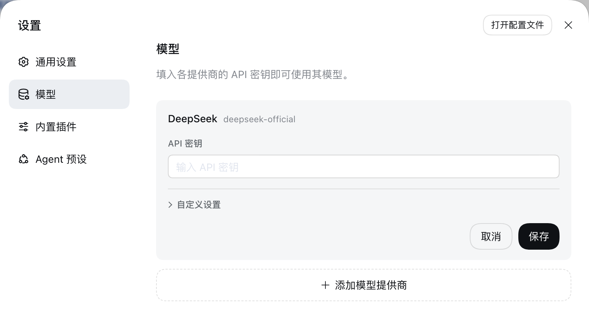
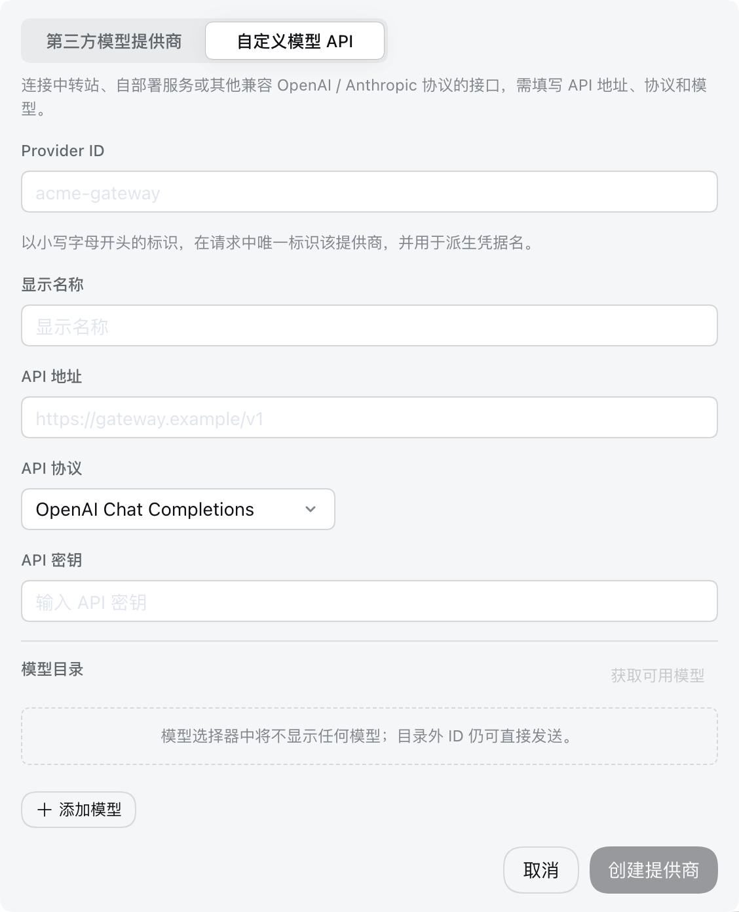

# 設定模型

[English](providers.md) | 中文

本指南假定你已按照[根 README](../../../README.zh.md#run)啟動 Web UI。模型變更會在下一次請求時生效，不需要重新啟動伺服器。

## 設定 DeepSeek

開啟**設定 → 模型**。DeepSeek 卡片提供一個 API 金鑰欄位；輸入金鑰並儲存。



金鑰是隻寫的。儲存後，頁面只會收到脫敏描述符，永遠不會收到明文金鑰。金鑰儲存在 `$DSH_HOME/.credentials.yaml` 中，settings 只保留它的憑證引用。

## 新增第三方提供商

選擇**新增模型提供商**。卡片預設開啟在**第三方模型提供商**：選取 dsh 自帶的提供商——列表顯示的是提供商 id，例如 `anthropic`、`openai`、Kimi 對應的 `moonshotai`、GLM 對應的 `zai`——輸入其 API 金鑰並儲存。已安裝目錄會提供端點、協定和模型列表。

透過 OAuth 登入的提供商（例如 Codex）暫不支援。

## 新增自定義模型 API

對於中轉站、公司閘道、自建伺服器或已安裝目錄中不存在的提供商，把卡片切換到**自定義模型 API**。提供小寫 Provider ID、基礎 URL、API 協定、憑證和至少一個模型。**API 協定**必須選閘道實際使用的那一種，選擇框提供三種：OpenAI Chat Completions、OpenAI Responses 和 Anthropic Messages，在目前 profile 的 `cordis.patch.yml` 中分別存為 `openai-completions`、`openai-responses` 和 `anthropic-messages`。一個提供商只使用一種協定，閘道同時提供兩種時需要建兩個提供商。



Provider ID 是永久的，因為請求、已儲存工作階段、模型預設值和憑證引用都會使用它。如需重新命名提供商，請新增新提供商並刪除舊提供商。顯示名稱、基礎 URL、協定、憑證和模型仍可編輯。

### 探測模型

在**模型目錄**中選擇**取得可用模型**，即可詢問端點它提供哪些模型。請求使用表單目前的 API 地址、協定和金鑰，已儲存的提供商則用已儲存的金鑰；回應會開啟一個可搜尋的選擇框，搜尋、勾選想要的模型，再點**新增所選**。儲存或建立提供商之前不會儲存任何內容。

探測讀取的是常見閘道公開的列表格式，但並非每個端點都用這些格式作答，所以它只是便利手段而非保證：探測失敗或列表為空時，手動新增模型 ID 即可，效果完全一樣。內建提供商一律由已安裝目錄作答，即使其 API 地址指向閘道也是如此，要檢視閘道實際提供的模型，請透過自定義提供商探測。

## 選擇模型

已設定的提供商會出現在模型選擇器中。選擇模型也會將其設為新工作階段的預設值。已傳送過請求的工作階段會保留自身日誌中記錄的模型。

如果已儲存預設值指向已刪除的提供商，輸入框會顯示**選擇模型**，並在選擇其他模型前阻止輸入。

## 進階設定

自動生成的[外掛設定目錄](../../config-catalog.zh.md)列出每個外掛的所有受支援欄位與預設值；[`dsh-llm-pi-ai`](../../config-catalog.zh.md#deepseek-aidsh-llm-pi-ai) 就是本頁所設定的那個提供商段落。[`dsh-llm-pi-ai`](../../../packages/llm/llm-pi-ai/README.zh.md) 和 [`dsh-llm-deepseek`](../../../packages/llm/llm-deepseek/README.zh.md) 參考文件負責直接 `cordis.patch.yml` 設定、目錄解析、推理控制、憑證與介面卡錯誤。

::: tip 其他設定
模型頁提供 API 金鑰、顯示名稱、API 地址、API 協定，以及每個模型的 ID、顯示名稱、上下文視窗、最大輸出 token 數和輸入型別。推理等級、請求相容性開關、請求頭、超時和重試策略在 `$DSH_HOME/profiles/<profile>/cordis.patch.yml` 中設定，也就是模型頁寫入的同一份文件。可以直接編輯它；瀏覽器與伺服器在同一臺機器時，也可以點選設定頁頂部的**開啟設定檔**開啟它。介面卡會在下一次請求時重新讀取，無需重新啟動任何東西。下面各小節介紹多數閘道會用到的欄位。

按常規方式透過 `dsh web` 啟動 Web UI 時，`<profile>` 就是 `web`，完整路徑為 `$DSH_HOME/profiles/web/cordis.patch.yml`。如果使用自定義 profile，請替換為啟動時指定的名稱。
:::

### 圖片輸入

在**設定 → 模型**中編輯提供商，開啟**自定義設定**並展開該模型的**模型選項**。**輸入型別**獨佔容量欄位下方的一行。對於支援圖片的模型，勾選**圖片**並儲存。沒有繼承圖片能力的新自定義模型預設勾選**文字**。至少保留一種輸入型別；僅圖片模型需先勾選圖片，再取消文字。

核取方塊將 pi-ai 模型的選擇儲存為 `input`，將直連 DeepSeek 介面卡的選擇儲存為 `inputModalities`。也可以在 `$DSH_HOME/profiles/<profile>/cordis.patch.yml` 中編輯模型；例如，以下自定義 pi-ai 提供商宣告瞭一個純文字模型和一個視覺模型：

這些範例展示 profile patch 中的設定欄位。Cordis 設定覆蓋會替換完整條目設定；編輯已有覆蓋項時，請保留其他 provider 和欄位。

```yaml
- id: llm-pi-ai
  config:
    providers:
      my-gateway:
        apiKeyEnv: GATEWAY_API_KEY
        api: openai-completions
        baseURL: https://gateway.example/v1
        models:
          - id: legacy-chat
          - id: vision-preview
            input: [text, image]
```

Pi-ai 的 `input` 接受 `text` 和 `image`，且只作用於該模型。顯式的非空選擇優先。省略或為空的 `input` 先繼承已安裝目錄的輸入型別，再退回到路由的 `defaultInput`，後者預設為 `[text]`。核取方塊會顯示這些繼承值，僅開啟模型行不會儲存覆蓋值。

DeepSeek 將省略的 `inputModalities` 視為純文字，並拒絕空列表。取消圖片還會移除該模型的 `imagePixelBudget` 和 `imageMaxBytes`，因為 DeepSeek 拒絕純文字模型上的圖片限制。以後重新啟用圖片且需要自定義限制時，需再次設定這些限制。

修改核取方塊後如需恢復繼承，可在 `cordis.patch.yml` 中移除模型的 `input` 或 `inputModalities` 欄位。**恢復預設模型**會移除整個模型目錄覆蓋，包括其他模型編輯，因此僅在需要恢復整個目錄時使用。

如果你手動錄入的模型全都接受圖片，可以在路由上設定一次退回值，不必逐個模型寫：

```yaml
- id: llm-pi-ai
  config:
    providers:
      vision-gateway:
        apiKeyEnv: GATEWAY_API_KEY
        api: openai-completions
        baseURL: https://vision.example/v1
        defaultInput: [text, image]
        models:
          - id: first-model
          - id: second-model
```

`defaultInput` 是退回值而不是覆蓋值，預設為 `[text]`：在內建提供商上，它只為其目錄未描述的模型作答，因此絕不會把目錄中本就具備圖片能力的模型的該能力去掉。要收窄這類模型，請用它自己的 `input`。內建提供商沒有顯式 `models` 列表時，寫在 `modelOverrides` 下，以模型 id 為鍵：

```yaml
- id: llm-pi-ai
  config:
    providers:
      anthropic:
        modelOverrides:
          claude-sonnet-4-5:
            input: [text]
```

在 pi-ai 設定中，除模型自身的 `input` 外，每個列表都至少要寫一項模態；模型自身的空列表與省略它同義。未知模態在任何位置寫入都會被拒絕。

這兩個欄位都是對你端點的斷言，而不是對它的檢查。宣告瞭端點並不提供的圖片能力的模型不會在這裡被攔下，改由提供商拒絕該請求。

### 推理等級

對於宣告瞭推理等級的模型，模型選擇器會提供**推理等級**選單。內建提供商的模型從已安裝目錄繼承其等級。手動錄入的模型不宣告任何等級，因此模型選單裡不會出現推理等級項，由端點自身的預設值決定模型是否思考。請在 `$DSH_HOME/profiles/<profile>/cordis.patch.yml` 中用 `reasoningEfforts` 宣告等級：

```yaml
- id: llm-pi-ai
  config:
    providers:
      my-gateway:
        apiKeyEnv: GATEWAY_API_KEY
        api: openai-completions
        baseURL: https://gateway.example/v1
        reasoning: high
        models:
          - id: my-reasoner
            reasoningEfforts:
              off:
              high: high
              max: max
```

每個鍵都是選單提供的一個等級，其值是在協定上以 `reasoning_effort` 傳送的寫法，因此 `max: xhigh` 可以為自有一套詞彙的閘道重新命名某個等級。只有 `off` 可以留空，因為對多數端點來說，不思考就是不傳該參數。路由的 `reasoning` 是工作階段尚未選擇等級時採用的等級；在選擇器中選定某個等級後，它會與模型一起儲存為新工作階段的預設值。

留空的 `off` 什麼都不傳送，這隻能讓「按請求才思考」的模型停下來；給 `off` 一個值，則會把該值作為 `reasoning_effort` 傳送。對於「不明確關閉就會思考」的模型——例如 OpenAI 相容閘道後面的 DeepSeek V4——需要 `compat.thinkingFormat: deepseek`：它讓 `off` 傳送 `thinking: {type: disabled}`，其他每個等級則在 effort 之外再傳送 `thinking: {type: enabled}`：

```yaml
        models:
          - id: deepseek-v4-pro
            compat:
              thinkingFormat: deepseek
            reasoningEfforts:
              off:
              high: high
              max: max
```

閘道並不提供推理能力的內建提供商模型，可在 `modelOverrides` 下用 `reasoningEfforts: false` 去掉其等級；之後再為它選擇等級會被拒絕並報 `UNSUPPORTED_REASONING_EFFORT`。DeepSeek 自身的路由不需要以上任何設定：其模型已經提供 `off`、`low`、`high` 和 `max`，`llm-deepseek.reasoningEffort` 設定選擇器的起始預設值：

```yaml
- id: llm-deepseek
  config:
    reasoningEffort: max
```

### 請求相容性

閘道可能持有可用的金鑰、地址也通得到，卻仍然拒絕每一個請求。pi-ai 依據端點的 URL 決定請求的形狀——系統提示詞由哪個角色承載、輸出上限寫在哪個欄位、思考級別如何傳輸——而對於它無法識別的地址，會當作 OpenAI 本身來對待。多數 OpenAI 相容閘道至少會拒絕 OpenAI 所接受的某一樣東西。

其中兩樣佔了絕大多數。宣告瞭推理能力的模型，其系統提示詞會以 `role: "developer"` 發出，很多閘道直接拒絕；輸出上限則寫作 `max_completion_tokens`，只認 `max_tokens` 的伺服器端會拒絕。表單裡沒有這兩個欄位；請在 `$DSH_HOME/profiles/<profile>/cordis.patch.yml` 的路由上更正：

```yaml
- id: llm-pi-ai
  config:
    providers:
      my-gateway:
        apiKeyEnv: GATEWAY_API_KEY
        api: openai-completions
        baseURL: https://gateway.example/v1
        compat:
          supportsDeveloperRole: false
          maxTokensField: max_tokens
        models:
          - id: my-model
```

路由的 `compat` 是其模型的預設值，模型自身的則逐欄位勝出，因此更正某一個模型無需重述整條路由：

```yaml
        models:
          - id: my-model
          - id: my-reasoner
            compat:
              thinkingFormat: deepseek
```

兩者都未設定的欄位，沿用已安裝 catalog 為該模型記錄的值；catalog 也未描述的，落到 pi-ai 的檢測。凡是寫下的開關都要給值：冒號後留空的鍵（`supportsDeveloperRole:`）會被拒絕而不是被忽略，因為空值會抹掉 catalog 已知的資訊，卻又沒有給出任何替代。任何協定都不接受的名字同樣會被拒絕，報錯會列出可用的那些。

每個開關歸屬於宣告瞭它的那些協定，因此在某個 `api` 上合法的開關，在另一個上可能被拒絕——報錯會點名該協定實際提供哪些。與上面的 `input` 一樣，開關陳述的是關於你的端點的一個斷言，而不是對它的檢查：設定一個閘道其實並不需要的開關，只是發出一個不同的請求而已。

全部開關、各自接受的取值，以及接受它們的協定，都列在[生成的 `dsh-llm-pi-ai` 設定參考](../../config-catalog.zh.md#deepseek-aidsh-llm-pi-ai)的 `PiAiCompatProfile` 之下——該參考派生自原始碼，因此不會落後於介面卡實際接受的內容。

## 排錯

- **`MISSING_CREDENTIAL`**：透過模型頁儲存提供商金鑰，或提供被引用的環境變數。
- **`UNKNOWN_MODEL`**：選擇已設定的模型，或向自定義提供商新增缺失的模型。
- **取得可用模型返回 401**：檢查金鑰。模型發現會呼叫 OpenAI 相容的 `GET /models` 端點；對於不提供該端點的服務，請手動輸入模型。
- **取得可用模型提示既沒有 `data` 陣列也沒有 `models` 物件**：端點返回的列表格式不在探測的讀取範圍內。請手動輸入模型。
- **金鑰與地址都正確，閘道卻拒絕每一個請求**：它的請求形狀與 OpenAI 不同。先在路由上設 `compat.supportsDeveloperRole: false` 與 `compat.maxTokensField: max_tokens`。
- **只有推理模型失敗**：pi-ai 把它們的系統提示詞以 `developer` 角色發出，而閘道拒絕該角色。設 `compat.supportsDeveloperRole: false`。
- **手動錄入的模型沒有推理等級選單**：該模型沒有宣告任何等級。在 `cordis.patch.yml` 中給該模型加上 `reasoningEfforts`。
- **`off` 無法讓 DeepSeek 模型停止思考**：留空的 `off` 不傳送任何推理欄位，預設思考的端點就繼續思考。請在模型或路由上設定 `compat.thinkingFormat: deepseek`。
- **某個 compat 開關因沒有值而被拒絕**：冒號後什麼都沒寫。給它一個值，或刪掉該鍵以沿用已安裝 catalog 的值。
- **圖片在傳送前被拒絕**：該模型未宣告圖片模態。請給自定義提供商的模型加上 `input: [text, image]`；在 DeepSeek 自身的路由上，請從設定的目錄中選擇支援圖片的條目（預設為 `deepseek-flash`），並確認閘道提供該模型且支援圖片輸入。
- **提供商拒絕了帶圖片的請求**：該模型宣告瞭其端點實際並不提供的圖片能力。請從授予它圖片能力的那個列表中移除 `image`——可能是模型的 `input`，也可能是路由的 `defaultInput`——然後開啟新工作階段：附加的圖片會留在工作階段日誌裡，因此在工作階段離開它之前，同一個請求會不斷重複。
